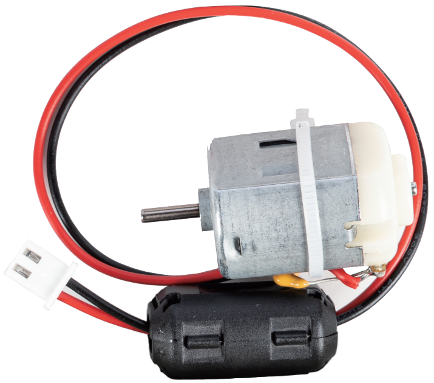
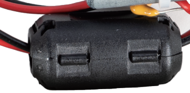
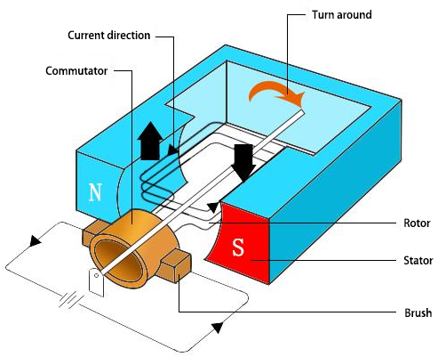

.. note::

    Hello, welcome to the SunFounder Raspberry Pi & Arduino & ESP32 Enthusiasts Community on Facebook! Dive deeper into Raspberry Pi, Arduino, and ESP32 with fellow enthusiasts.

    **Why Join?**

    - **Expert Support**: Solve post-sale issues and technical challenges with help from our community and team.
    - **Learn & Share**: Exchange tips and tutorials to enhance your skills.
    - **Exclusive Previews**: Get early access to new product announcements and sneak peeks.
    - **Special Discounts**: Enjoy exclusive discounts on our newest products.
    - **Festive Promotions and Giveaways**: Take part in giveaways and holiday promotions.

    👉 Ready to explore and create with us? Click [|link_sf_facebook|] and join today!

.. _cpn_motor_clamp:

DC Motor 6500 RPM with Ferrite Clamp
=========================================

This is the 3 V DC motor supplied with the kit. It is a brushed motor on a 20 cm cable with a 2-pin XH2.54 plug on the end, and a ferrite clamp moulded around the cable close to the body — that clamp is what keeps this motor quiet enough to sit next to the camera, the microphone and the analog inputs.

**Specifications**

* **Operating Voltage**: 3 V
* **Free-run Speed**: 6500 RPM
* **Free-run Current**: < 150 mA
* **Start-up Current**: < 200 mA
* **Connector**: XH2.54 2P (white)
* **Cable**: Red and black, 20 cm, 24 AWG
* **Ferrite Clamp**: Nickel-zinc, UF35A, 3.5 mm bore

**The Plug**

The 2-pin XH2.54 plug goes straight into the **M0** or **M1** motor terminal on the Robot Shield, so there is nothing to solder and no driver board to wire up. Which way the shaft turns depends on which of the two pins is positive — swap the plug, or set the direction in the project's motor call.

**The Ferrite Clamp**

A brushed motor makes and breaks contact many times per revolution, and every one of those sparks radiates high-frequency noise. That noise travels back down the power wires and can reach the rest of the board — the usual symptoms are a sensor that jumps, a servo that twitches, or an analog reading that wanders whenever the motor runs.

The nickel-zinc ferrite absorbs those high-frequency currents and turns them into a little heat, so much less of the noise leaves the cable. It does nothing to the DC the motor actually uses, which is why the cable can pass through it untouched. Leave it fitted; if you ever have to refit it, press the latch until both halves meet.

**How It Works**

A DC motor consists of two main components: the **stator**, which remains fixed, and the **rotor** (or **armature**), which rotates to generate motion.
The rotor is placed within a magnetic field created by permanent magnets. When current flows through the armature windings, it produces a magnetic field that interacts with the stator's field, generating torque that causes rotation.

Current flows from the power supply to the brushes, into the commutator, and then to the armature windings.
The commutator periodically reverses the current direction every half-turn, ensuring that the torque always acts in the correct direction to maintain continuous rotation.
